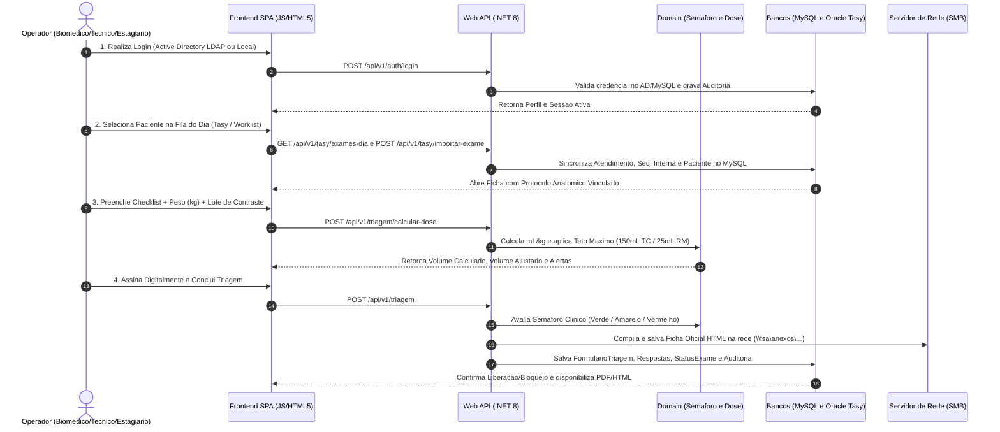
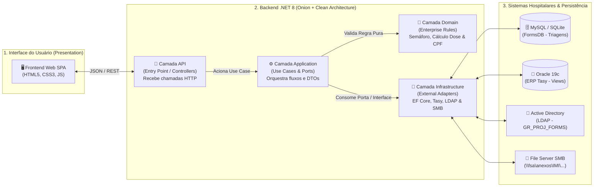
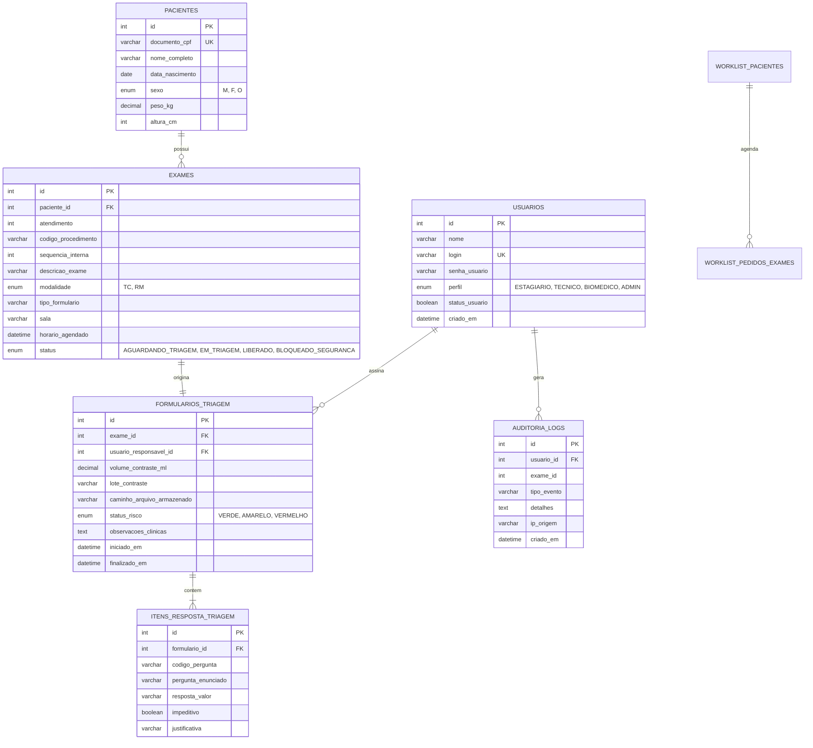

# 🏥 Sistema de Triagem Clínica para Diagnóstico por Imagem (TC & RM)


Plataforma corporativa Web (SPA) e API RESTful em **.NET 8** desenvolvida para o **Posto de Triagem Clínica em Serviços de Diagnóstico por Imagem**. O sistema automatiza e blinda a recepção e avaliação de segurança de pacientes agendados para **Tomografia Computadorizada (TC)** e **Ressonância Magnética (RM)**, integrando-se em tempo real ao **ERP Hospitalar Oracle Tasy**, ao **Active Directory (LDAP)** e ao **Servidor de Arquivos em Rede (SMB)**, aplicando protocolos clínicos baseados no **Checklist da Aviação (Semáforo Clínico Verde, Amarelo e Vermelho)** e diretrizes do CBR/ACR.

---

## 1. 🎯 O Problema e a Solução

Em centros de diagnóstico por imagem, a realização de anamnese pré-exame em fichas de papel expõe o serviço a falhas graves: entrada acidental de portadores de marcapasso cardíaco ou clipes de aneurisma em salas de RM, erro de cálculo manual de contraste iodado/gadolínio, divergência cadastral com o sistema hospitalar e extravio de fichas físicas.

### Principais Funcionalidades Desenvolvidas:

1. **Integração Direta com o ERP Hospitalar Oracle Tasy (`192.1.1.12:1521/tasytst`)**:
   - **Fila Diária em Tempo Real (`TASY.IMI_EXAMES_DIA_FORM_V`)**: Lista os atendimentos do dia diretamente do Tasy, cruzando automaticamente com o banco MySQL local para exibir quais exames já foram triados, liberados ou bloqueados.
   - **Sincronismo Oficial de Procedimentos (`TASY.IMI_EXAMES_PROC_INTERNO_V`)**: A associação de exames aos formulários de triagem é feita exclusivamente por busca direta no catálogo oficial do Tasy (por nome, código `CD_PROCEDIMENTO` ou sequência interna `NR_SEQUENCIA`), eliminando erros humanos de digitação e garantindo vínculo automático do protocolo ao iniciar a triagem.
   - **Identificação Automática de Posto de Trabalho (Workstation)**: Reconhece o IP/Hostname da estação cliente e define automaticamente a sala operacional correspondente (ex.: `RM-01`, `TC-01`).

2. **Questionários Clínicos Especializados e Expansíveis**:
   - Carrega dinamicamente o protocolo anatômico vinculado ao exame do Tasy:
     * **RM de Coluna (Cervical / Torácica / Lombar)**
     * **RM de Braço / Antebraço (Membro Superior)**
     * **RM de Bacia / Quadril (Articulação Coxofemoral)**
     * **TC de Tórax com Contraste Iodado**
     * **TC de Abdômen Total com Contraste**
     * **Protocolos Customizados**: Painel administrativo permite criar novos protocolos anatômicos (ex.: *RM Crânio*, *RM Joelho*), ordenar a sequência das perguntas e vincular múltiplos procedimentos do Tasy.

3. **Motor de Semáforo Clínico (Checklist da Aviação)**:
   - 🟢 **VERDE (Liberado)**: Ausência de contraindicações. Exame apto para execução imediata.
   - 🟡 **AMARELO (Alerta Operacional)**: Condições que exigem cautela ou orientação (ex.: suspensão de Metformina por 48h na TC, acolhimento/sedação para claustrofobia na RM, jejum parcial).
   - 🔴 **VERMELHO (Bloqueio Absoluto de Segurança)**: Contraindicações impeditivas (marcapasso cardíaco não compatível, clipe de aneurisma cerebral, corpo estranho metálico ocular em RM ou histórico de anafilaxia grave a iodo em TC). **Bloqueia compulsoriamente a liberação do exame.**

4. **Calculadora Farmacológica de Contraste com Trava de Teto Máximo**:
   - **Tomografia (Contraste Iodado)**: $1,5\text{ mL/kg}$ com trava rígida em **$150\text{ mL}$** (prevenção de Nefropatia Induzida por Contraste).
   - **Ressonância (Gadolínio)**: $0,2\text{ mL/kg}$ com trava rígida em **$25\text{ mL}$**.
   - Registro obrigatório de **Lote do Contraste** para rastreabilidade sanitária (ANVISA).

5. **Autenticação Corporativa Active Directory (LDAP) & Permissões Unificadas**:
   - Autenticação integrada ao domínio institucional (`10.250.220.200:389` — grupo `GR_PROJ_FORMS`) com fallback para credenciais locais criptografadas via `BCrypt`.
   - **Biomédicos (`BIOMEDICO`)**, **Técnicos de RM (`TECNICO`)** e **Estagiários (`ESTAGIARIO`)** compartilham as mesmas permissões operacionais clínicas (abrir ficha, preencher checklist, dosar contraste e assinar digitalmente), enquanto o perfil **`ADMIN`** gerencia operadores, salas, parâmetros e auditoria.

6. **Emissão de Ficha Timbrada e Arquivamento em Rede (SMB)**:
   - Ao finalizar a triagem, o sistema compila uma ficha clínica oficial em HTML timbrado e a grava automaticamente no compartilhamento de rede institucional:
     `\\fsa\anexos\IMI\Anexos_Formularios_PROJ\`
   - O caminho físico é salvo na coluna `caminho_arquivo_armazenado` no banco de dados e pode ser aberto/impresso diretamente pela grade da Worklist ou do painel Tasy.

---

## 2. 🔄 Fluxo Completo da Aplicação (Ponta a Ponta)

O diagrama abaixo demonstra o caminho percorrido pela informação desde a ação do usuário no navegador até os bancos de dados e o servidor de arquivos:



---

## 3. 🏗️ Arquitetura do Sistema (Evolução: Onion Architecture + Clean Architecture)

Ao longo do desenvolvimento, a arquitetura do projeto evoluiu: nasceu estruturada em **Onion Architecture (Arquitetura em Cebola)** para proteger o núcleo clínico e, com a entrada das integrações corporativas externas (Oracle Tasy, Active Directory LDAP e Servidor de Arquivos SMB), **passou a englobar também os padrões da Clean Architecture (Arquitetura Limpa)**:

* **Herança da Onion Architecture:** O núcleo (`TriagemImagem.Domain`) permanece no centro absoluto com zero dependências externas, abrigando as Entidades, *Value Objects* (`Cpf`, `DoseContraste`) e o serviço de domínio puro (`SemaforoClinicoDomainService`).
* **Evolução para Clean Architecture:** A camada `TriagemImagem.Application` passou a atuar como camada de **Casos de Uso (*Use Cases / Interactors*)**, definindo *Ports* (interfaces de saída como `IFileStorageService`) e DTOs estritos, enquanto a `TriagemImagem.Infrastructure` atua como camada de **Adaptadores Externos (*Adapters*)** para os bancos de dados (MySQL/SQLite e Oracle 19c), diretório de rede (LDAP) e sistema de arquivos (SMB), injetados via Inversão de Dependência (`ServiceCollectionExtensions`).



### Responsabilidade de Cada Camada:

| Ordem | Camada / Projeto | O que ela faz na prática? |
| :---: | :--- | :--- |
| **1º** | **`frontend/` (Interface Web SPA)** | É a tela utilizada pelo Biomédico/Técnico. Exibe a fila do Tasy, o questionário clínico, o semáforo visual e envia as requisições JSON para a API. |
| **2º** | **`TriagemImagem.Api` (Entrada HTTP)** | Recebe as chamadas do Frontend nos *Controllers* (`TasyController`, `TriagemController`, `WorklistController`, `AuthController`, `AdminController`), trata erros globalmente (`ExceptionHandlingMiddleware`) e expõe o Swagger. |
| **3º** | **`TriagemImagem.Application` (Casos de Uso)** | Coordena o passo a passo de cada operação: recebe os DTOs da API, aciona o Domínio para validar as regras médicas, manda salvar no banco e gera o HTML timbrado da ficha (`RelatorioTriagemAppService`). |
| **4º** | **`TriagemImagem.Domain` (Coração / Regras)** | Guarda as regras clínicas e matemáticas puras (sem depender de banco de dados): avalia o Semáforo Verde/Amarelo/Vermelho (`SemaforoClinicoDomainService`), aplica o teto de contraste (`DoseContraste`) e valida o `Cpf`. |
| **5º** | **`TriagemImagem.Infrastructure` (Integrações)** | Conecta o sistema ao mundo externo: grava no **MySQL/SQLite** via Entity Framework Core, consulta as views do **Oracle Tasy** (`TasyService`), autentica no **Active Directory** (`LdapService`) e salva os arquivos na rede **SMB** (`FileStorageService`). |

### Estrutura de Pastas do Projeto:

```text
TriagemImagem.sln
│
├── TriagemImagem.Domain/            # Núcleo de Regras de Negócio (Zero dependências externas)
│   ├── Configurations/              # LdapSettings, TasySettings, StorageSettings
│   ├── Entities/                    # Usuario, Paciente, Exame, FormularioTriagem, AuditoriaLog...
│   ├── ValueObjects/                # Cpf (Módulo 11), DoseContraste (Fórmulas e Tetos)
│   ├── Enums/                       # StatusExame, StatusRiscoSemaforo, ModalidadeExame, PerfilUsuario
│   ├── Exceptions/                  # DomainException
│   ├── Repositories/                # Contratos (Interfaces) dos Repositórios
│   └── Services/                    # SemaforoClinicoDomainService (Checklist da Aviação)
│
├── TriagemImagem.Application/       # Casos de Uso e Orquestração
│   ├── DTOs/                        # Objetos de transferência de dados (Request / Response)
│   ├── Interfaces/                  # Contratos dos AppServices e IFileStorageService
│   ├── Services/                    # TriagemAppService, WorklistAppService, RelatorioTriagemAppService...
│   └── Validators/                  # Validações de entrada de triagem e contraste
│
├── TriagemImagem.Infrastructure/    # Persistência e Integrações Corporativas
│   ├── Data/                        # AppDbContext, WorklistLabDbContext, Fluent API, DbSeeder
│   ├── Repositories/                # Repositórios EF Core (MySQL / SQLite)
│   └── Services/                    # TasyService (Oracle), LdapService (AD), FileStorageService (SMB)
│
├── TriagemImagem.Api/               # Camada Web API RESTful (.NET 8)
│   ├── Controllers/                 # Auth, Tasy, Worklist, Triagem, Admin, Auditoria, DatabaseHealth
│   ├── Middlewares/                 # ExceptionHandlingMiddleware
│   └── Program.cs                   # Inicialização, Auto-detecção de Banco, CORS e Swagger
│
├── TriagemImagem.Tests/             # Suíte com 60+ Testes Automatizados (xUnit, Moq, FluentAssertions)
│   ├── Domain/                      # Testes de CPF, Dose de Contraste e Semáforo Clínico
│   ├── Application/                 # Testes de Serviços, Laudos HTML e Regras de Worklist
│   ├── Api/                         # Testes de Integração HTTP dos Endpoints REST
│   └── Services/                    # Testes de conectividade Oracle Tasy e Storage SMB
│
├── frontend/                        # Aplicação Web SPA (Glassmorphism Dark/Light)
│   ├── css/style.css                # Estilização responsiva e temas visuais
│   ├── js/api.js                    # Cliente HTTP REST integrado à API .NET
│   ├── js/app.js                    # Estado da aplicação, integração Tasy e painel Admin
│   └── index.html                   # Interface única do posto de triagem
│
├── schema_producao.sql              # Script DDL unificado para MySQL de produção (FormsDB)
└── deploy.ps1                       # Pipeline automatizado de build Linux-x64 e deploy via SSH/PM2
```

---

## 4. 🗄️ Modelagem do Banco de Dados

O banco relacional principal (`FormsDB` no MySQL / `triagem_imagem.db` em modo portátil SQLite) armazena todo o histórico clínico e de auditoria, trabalhando em conjunto com as views do **Oracle Tasy**:



---

## 5. 📡 Principais Endpoints da API RESTful

A documentação interativa **Swagger OpenAPI** está disponível em `/swagger` (ex.: `https://formularios.imi.local/swagger` ou `http://localhost:5000/swagger`):

| Módulo | Método | Rota | Finalidade |
| :--- | :---: | :--- | :--- |
| **Autenticação** | `POST` | `/api/v1/auth/login` | Autentica o operador via Active Directory (LDAP) ou banco local (BCrypt). |
| **Autenticação** | `GET` | `/api/v1/auth/ldap/status` | Verifica conectividade com o servidor LDAP e existência do grupo `GR_PROJ_FORMS`. |
| **Oracle Tasy** | `GET` | `/api/v1/tasy/status` | Testa conexão e latência com o Oracle 19c e total de procedimentos na view. |
| **Oracle Tasy** | `GET` | `/api/v1/tasy/procedimentos` | Pesquisa procedimentos em `TASY.IMI_EXAMES_PROC_INTERNO_V` por nome, código ou sequência. |
| **Oracle Tasy** | `GET` | `/api/v1/tasy/exames-dia` | Consulta exames do dia em `TASY.IMI_EXAMES_DIA_FORM_V` cruzando status com o MySQL local. |
| **Oracle Tasy** | `POST` | `/api/v1/tasy/importar-exame` | Importa e sincroniza um exame do Tasy para a base local de triagem. |
| **Oracle Tasy** | `GET` | `/api/v1/tasy/workstation` | Detecta IP/Hostname da estação e retorna a sala mapeada (`RM-01`, `TC-01`). |
| **Worklist** | `GET` | `/api/v1/worklist` | Lista agendamentos locais com filtros por modalidade, status e busca textual. |
| **Worklist** | `POST` | `/api/v1/worklist/{id}/chamar` | Registra chamada do paciente para a cabine e grava log de auditoria. |
| **Triagem** | `POST` | `/api/v1/triagem/calcular-dose` | Calcula dosagem clínica de contraste (TC/RM) aplicando tetos de segurança. |
| **Triagem** | `POST` | `/api/v1/triagem` | Processa o checklist, avalia o Semáforo Clínico e salva a ficha HTML no servidor SMB. |
| **Triagem** | `GET` | `/api/v1/triagem/exame/{exameId}` | Obtém os dados e respostas de uma triagem realizada ou em rascunho. |
| **Admin** | `POST/PUT/DELETE` | `/api/v1/admin/exames...` | Gestão operacional da grade, edição, transferência de sala e reset de status. |
| **Admin** | `GET/POST` | `/api/v1/admin/usuarios...` | Cadastro de operadores, ativação/inativação e reset de senha. |
| **Auditoria** | `GET` | `/api/v1/auditoria` | Consulta a trilha de auditoria operacional completa. |
| **Diagnóstico** | `GET` | `/api/v1/database/status` | Painel consolidado de saúde dos bancos (MySQL, Worklist Lab, Oracle Tasy e SMB). |

---

## 6. 💻 Tecnologias Utilizadas

| Categoria | Tecnologia | Finalidade |
| :--- | :--- | :--- |
| **Backend & Runtime** | **C# 12 / .NET 8 (LTS)** | Construção da Web API RESTful e regras de domínio orientadas a objetos. |
| **ORM & Bancos de Dados** | **EF Core 8 (MySQL / SQLite) & Oracle ManagedDataAccess** | Persistência relacional no MySQL (`FormsDB`), fallback SQLite e leitura no Oracle 19c (Tasy). |
| **Segurança & Diretório** | **LDAP (`System.DirectoryServices.Protocols`) & BCrypt.Net** | Autenticação corporativa no Active Directory e hash criptográfico irreversível. |
| **Frontend** | **HTML5, CSS3 (Glassmorphism) & Vanilla JavaScript (ES6+)** | Interface clínica responsiva, suporte Dark/Light Mode e atalhos de teclado. |
| **Qualidade & Testes** | **xUnit, Moq, FluentAssertions & Swagger OpenAPI** | Mais de 60 testes automatizados de unidade/integração e documentação viva da API. |
| **Infraestrutura & Deploy** | **Linux (CloudPanel), Nginx, PM2, SMB & PowerShell** | Hospedagem com proxy reverso HTTPS (`formularios.imi.local`), arquivamento em rede e deploy automatizado. |

---

## 7. 🚀 Como Executar e Testar o Projeto

### 1. Executar Localmente
O sistema conta com **Auto-Detecção de Banco de Dados (Zero-Config)**: se o MySQL não estiver acessível localmente, ele cria e popula automaticamente os bancos em **SQLite Portátil**.

```powershell
dotnet run --project TriagemImagem.Api --urls "http://localhost:5000"
```
Acesse no navegador: **`http://localhost:5000`** (ou **`http://localhost:5000/swagger`** para o Swagger).

### 2. Executar a Suíte de Testes Automatizados
```powershell
dotnet test
```

### 3. Publicar em Produção (Servidor Linux CloudPanel)
```powershell
powershell -ExecutionPolicy Bypass -File .\deploy.ps1
```

### 4. Credenciais Locais de Demonstração (Fallback / Homologação)
Além do login corporativo via Active Directory (LDAP), os seguintes usuários locais estão disponíveis para avaliação:

| Perfil | Login | Senha | Permissões |
| :--- | :--- | :--- | :--- |
| **Biomédico(a)** | `lucas.biomed` | `123456` | Operação clínica completa: triar, calcular dose, assinar e liberar/bloquear exames. |
| **Técnico(a) em RM** | `mariana.tec` | `123456` | Operação clínica completa: triar, calcular dose, assinar e liberar/bloquear exames. |
| **Estagiário(a)** | `gabriel.estagio` | `123456` | Operação clínica completa: triar, calcular dose, assinar e liberar/bloquear exames. |
| **Administrador** | `admin` | `123456` | Acesso total + Painel Administrativo (gestão de usuários, salas, protocolos Tasy e auditoria). |
