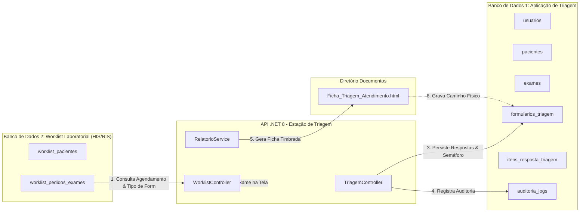

# 🏥 Sistema de Triagem para Diagnóstico por Imagem (TC & RM)


-00758F?logo=mysql&logoColor=white)


Aplicação web e API RESTful corporativa desenvolvida para o **Posto de Triagem Clínica em Serviços de Diagnóstico por Imagem**. O sistema automatiza a recepção e avaliação de segurança de pacientes agendados para **Tomografia Computadorizada (TC)** e **Ressonância Magnética (RM)**, aplicando protocolos de segurança baseados no modelo de **Checklist da Aviação** (Semáforo Clínico Verde, Amarelo e Vermelho) e diretrizes do CBR/ACR.

---

## 1. 📋 Descrição da Solução

Em centros de diagnóstico por imagem, incidentes como a entrada de pacientes portadores de marcapasso em salas de RM ou a administração de contraste iodado em pacientes nefropatas representam riscos severos à integridade do paciente. 

Esta solução atende às seguintes necessidades clínicas e operacionais:

1. **Consumo de Worklist Hospitalar (Conceito HIS/RIS - DICOM Modality Worklist)**:
   - Elimina retrabalho de cadastro e erros de digitação ao consumir os pedidos agendados diretamente do sistema do laboratório/hospital.
2. **Questionários Clínicos Especializados por Região Anatômica**:
   - O sistema reconhece o procedimento solicitado e carrega dinamicamente o formulário clínico correspondente (referenciado nas fichas do Instituto de Diagnóstico por Imagem):
     * **RM de Coluna (Cervical / Torácica / Lombar)**: Segmento examinado, irradiação de dor para membros, histórico cirúrgico com placas/parafusos, osteoporose e semáforo da aviação.
     * **RM de Braço / Antebraço (Membro Superior)**: Lado examinado (Direito/Esquerdo), prática de esportes/esforço repetitivo, suspeita de ruptura tendínea e histórico de cirurgias.
     * **RM de Bacia / Quadril (Articulações Coxofemorais)**: Lado, uso contínuo de corticosteroides (rastreamento de osteonecrose da cabeça femoral), histórico de doença na infância (Perthes/displasia) e lesão labral.
     * **TC de Tórax e Abdômen**: Rastreamento de nefropatia induzida por contraste, uso de metformina, jejum e gravidez.
3. **Avaliação Automatizada por Semáforo de Risco Clínico**:
   - **🟢 VERDE (Liberado)**: Ausência de contraindicações. Exame apto para execução imediata.
   - **🟡 AMARELO (Atenção / Protocolo Especial)**: Fatores que requerem ajuste (ex: metformina, profilaxia alérgica ou claustrofobia leve).
   - **🔴 VERMELHO (Bloqueio Absoluto)**: Presença de itens impeditivos de segurança clínica (marcapasso em RM, clipes ferromagnéticos, alergia prévia grave a iodo). O sistema bloqueia o exame no banco e impede a liberação.
4. **Calculadora de Dosagem de Meio de Contraste**:
   - Cálculo automático por peso corpóreo (TC: 1.5 mL/kg, teto 150 mL; RM: 0.2 mL/kg, teto 25 mL) com registro obrigatório de lote para rastreabilidade ANVISA.
5. **Arquivamento Digital Automático em Documentos**:
   - Ao finalizar a triagem, o sistema compila uma ficha clínica oficial timbrada em HTML com cabeçalho institucional, dados demográficos, respostas do questionário, resultado do semáforo, lote do contraste e assinatura do operador.
   - O documento é salvo automaticamente na pasta física do sistema operacional:
     `C:\Users\<usuario>\Documents\TriagensDiagnosticoImagem\`
   - O caminho físico completo é persistido na coluna `caminho_arquivo_armazenado` no banco de dados e registrado na trilha de auditoria.
6. **Gestão Dinâmica de Protocolos Anatômicos & Validação Estrita de Códigos TUSS e RIS**:
   - **Criação e Expansão Visual**: Administradores podem criar novos protocolos clínicos diretamente no painel (ex: `RM_CRANIO`, `TC_FACE`) definindo perguntas especializadas, criticidade de semáforo e regras impeditivas.
   - **Validação de Unicidade Global de TUSS e RIS**: O preenchimento do código TUSS (terminologia unificada da saúde suplementar) ou RIS é **estritamente obrigatório** e o sistema impede o cadastro de códigos duplicados ou já pertencentes a outro exame do catálogo.
   - **Fallback de Segurança Universal**: Se um exame for agendado com protocolo inédito ou não mapeado, o motor clínico aciona automaticamente as regras universais de segurança da modalidade (RM ou TC), garantindo zero travamentos e proteção máxima ao paciente.

---

## 2. 💻 Tecnologias Utilizadas

| Camada / Função | Tecnologia | Finalidade no Projeto |
| :--- | :--- | :--- |
| **Linguagem Principal** | C# 12 | Desenvolvimento orientado a objetos e regras de domínio ricas |
| **Plataforma / Runtime** | .NET 8 (LTS) | Framework de alta performance para a Web API e CLI |
| **Framework Web** | ASP.NET Core Web API | Criação de controllers RESTful, injeção de dependência e middlewares |
| **Mapeamento Objeto-Relacional** | Entity Framework Core 8 | Mapeamento relacional com Fluent API e controle transacional |
| **Bancos de Dados** | MySQL 8.0 & SQLite Portátil | Arquitetura Multi-Banco com auto-detecção por socket TCP |
| **Documentação Interativa** | Swagger / OpenAPI v1 | Exploração e teste interativo de todos os endpoints HTTP |
| **Criptografia / Segurança** | BCrypt.Net-Next | Hash irreversível de senhas de usuários operacionais |
| **Framework de Testes** | xUnit & Moq | Execução de testes unitários de domínio, serviços e API |
| **Frontend** | HTML5, Vanilla CSS3 & JavaScript (ES6+) | Interface responsiva Glassmorphism, atalhos de teclado e tema Dark/Light |
| **Tipografia & Ícones** | Outfit, Plus Jakarta Sans, JetBrains Mono & FontAwesome 6 | Ergonomia visual e identificação de status clínicos |

---

## 3. 🏗️ Estrutura do Projeto (Onion Architecture)

O projeto adota rigorosamente a **Onion Architecture (Arquitetura em Cebola)**, garantindo que o núcleo de regras de negócios e segurança clínica não dependa de frameworks ou bancos de dados externos:

```text
TriagemImagem.sln
│
├── TriagemImagem.Domain/            # 1. NÚCLEO DO DOMÍNIO (Sem dependências externas)
│   ├── Entities/                    # Entidades (Usuario, Paciente, Exame, FormularioTriagem, WorklistLab)
│   ├── ValueObjects/                # Objetos de Valor Imutáveis (Cpf, DoseContraste)
│   ├── Enums/                       # StatusExame, StatusRiscoSemaforo, ModalidadeExame, PerfilUsuario
│   ├── Exceptions/                  # DomainException (erros de regra de negócio)
│   ├── Repositories/                # Contratos dos Repositórios (IExame, ITriagem, IWorklistLab, etc.)
│   └── Services/                    # Regras puras do Semáforo Clínico (ISemaforoClinicoDomainService)
│
├── TriagemImagem.Application/       # 2. CAMADA DE APLICAÇÃO (Casos de Uso)
│   ├── DTOs/                        # Request e Response DTOs de Auth, Worklist, Triagem e Auditoria
│   ├── Interfaces/                  # Contratos de Serviços de Aplicação (ITriagemAppService, etc.)
│   ├── Services/                    # TriagemAppService, WorklistAppService, RelatorioTriagemAppService
│   ├── Validators/                  # TriagemValidator, DoseContrasteValidator
│   └── Extensions/                  # Registro de dependências da aplicação
│
├── TriagemImagem.Infrastructure/    # 3. CAMADA DE INFRAESTRUTURA (Persistência Externa)
│   ├── Data/
│   │   ├── Context/                 # AppDbContext (Banco 1) e WorklistLabDbContext (Banco 2)
│   │   ├── Configurations/          # Mapeamento Fluent API das entidades
│   │   └── Context/DbSeeder.cs      # Carga inicial automatizada de dados
│   ├── Repositories/                # Implementações EF Core dos repositórios
│   └── Extensions/                  # Registro de repositórios e contextos na DI
│
├── TriagemImagem.Api/               # 4. CAMADA DE ENTRADA HTTP (Web API REST)
│   ├── Controllers/                 # AuthController, WorklistController, TriagemController, AdminController, DatabaseHealthController
│   ├── Middlewares/                 # ExceptionHandlingMiddleware (captura global de DomainException -> 400)
│   ├── appsettings.json             # Strings de conexão dos Bancos 1 e 2
│   └── Program.cs                   # Pipeline ASP.NET Core, CORS, Swagger e inicialização de bancos
│
├── TriagemImagem.Tests/             # 5. TESTES AUTOMATIZADOS (58 Testes xUnit)
│   ├── Domain/                      # Testes de CPF, Dose de Contraste e Semáforo Clínico (22 testes)
│   ├── Application/                 # Testes de casos de uso, CRUD Admin, Laudos e Worklist (26 testes)
│   └── Api/                         # Testes de integração dos endpoints REST (10 testes)
│
├── schema.sql                       # Script DDL do Banco de Dados 1 (Triagem da Aplicação)
├── schema_worklist_lab.sql          # Script DDL do Banco de Dados 2 (Worklist do Laboratório)
│
└── frontend/                        # 6. POSTO DE TRABALHO CLÍNICO (Interface Web)
    ├── css/style.css                # Folha de estilo Glassmorphism Dark/Light
    ├── js/api.js                    # Cliente HTTP integrado à API .NET
    ├── js/app.js                    # Lógica da tela, atalhos de teclado e integração multi-banco
    └── index.html                   # Página única (SPA) do posto de triagem
```

---

## 4. ⚙️ Configuração do Ambiente

### Pré-requisitos:
* [.NET 8 SDK (versão 8.0.400 ou superior)](https://dotnet.microsoft.com/download/dotnet/8.0);
* Qualquer navegador web moderno (Google Chrome, Microsoft Edge, Firefox, Brave).

### Mecanismo de Auto-Detecção e Resiliência (Zero Config):
O sistema possui inteligência de inicialização no [Program.cs](file:///c:/Projetos/ProjetoFaculdade/TriagemImagem.Api/Program.cs):
* Ao iniciar, a API executa um teste de socket TCP na porta `3306` do `localhost`:
  * **Se o MySQL estiver ativo**: Conecta automaticamente nos bancos `triagem_imagem_db` e `worklist_lab_db`.
  * **Se o MySQL estiver ausente ou offline**: A API faz fallback imediato e transparente para o **SQLite Portátil** gerando localmente os bancos `triagem_imagem.db` e `worklist_lab.db`, executando a carga de dados (seed) sem que o avaliador precise instalar ou configurar servidores externos.

---

## 5. 🗄️ Arquitetura Multi-Banco de Dados

Para reproduzir a interoperabilidade real entre o sistema hospitalar (HIS/RIS) e o posto clínico de triagem, a aplicação opera com **dois bancos de dados desacoplados**:



### Tabelas do Banco de Dados 1 (`triagem_imagem.db` / `triagem_imagem_db`):
* `usuarios`: Operadores cadastrados (nome, login, senha com hash, perfil, status).
* `pacientes`: Cadastro demográfico (CPF, nome, nascimento, sexo, peso, altura).
* `exames`: Fila operacional do posto de atendimento, sala, horário, procedimento e status de liberação.
* `formularios_triagem`: Cabeçalho da sessão de triagem, status do semáforo, volume de contraste, lote e a coluna **`caminho_arquivo_armazenado`**.
* `itens_resposta_triagem`: Respostas detalhadas de cada questão com indicação de criticidade impeditiva.
* `auditoria_logs`: Histórico inviolável de rastreabilidade (quem realizou cada ação, quando e qual foi o resultado).

### Tabelas do Banco de Dados 2 (`worklist_lab.db` / `worklist_lab_db`):
* `worklist_pacientes`: Cadastro de pacientes do convênio/laboratório.
* `worklist_pedidos_exames`: Pedidos médicos agendados contendo `tipo_formulario` (`RM_COLUNA`, `RM_BRACO_ANTEBRACO`, `RM_BACIA_QUADRIL`, `TC_TORAX`, `TC_ABDOMEN`), `segmento_lado`, médico solicitante, CRM e convênio.

---

## 6. 🔐 Autenticação e Perfis de Acesso

A autenticação é efetuada via `POST /api/v1/auth/login`. Para avaliação da banca examinadora, os seguintes usuários já estão pré-configurados no banco de dados:

| Perfil de Acesso | Login | Senha | Permissões no Sistema |
| :--- | :--- | :--- | :--- |
| **Biomédico(a)** | `lucas.biomed` | `123456` | Acesso total: Realizar triagem, calcular dose de contraste, liberar exames e registrar bloqueios de segurança. |
| **Técnico(a) em Radiologia** | `mariana.tec` | `123456` | Operação diária: Chamar pacientes da fila, preencher checklists clínicos e salvar rascunhos. |
| **Administrador** | `admin` | `123456` | Gestão clínica: Visualizar relatórios e consultar trilha inviolável de auditoria. |

---

## 7. 📡 Endpoints da API RESTful

A documentação interativa Swagger pode ser acessada em: **`http://localhost:5000/swagger`**

| Módulo | Método | Rota | Descrição |
| :--- | :---: | :--- | :--- |
| **Autenticação** | `POST` | `/api/v1/auth/login` | Autentica o operador e retorna dados de perfil |
| **Worklist** | `GET` | `/api/v1/worklist` | Lista agendamentos do dia com filtros e busca |
| **Worklist** | `GET` | `/api/v1/worklist/{id}` | Obtém detalhes completos de um exame |
| **Worklist** | `POST` | `/api/v1/worklist/{id}/chamar` | Registra a chamada do paciente para a sala |
| **Banco 2 (Lab)** | `GET` | `/api/v1/worklist/laboratorio` | Consulta direta aos pedidos do Banco 2 do laboratório |
| **Triagem** | `POST` | `/api/v1/triagem` | Salva a triagem, avalia semáforo e gera relatório em `Documentos` |
| **Triagem** | `GET` | `/api/v1/triagem/exame/{exameId}` | Consulta o formulário de triagem de um exame |
| **Triagem** | `POST` | `/api/v1/triagem/calcular-dose` | Calcula dosagem clínica de contraste (TC/RM) |
| **Triagem** | `POST` | `/api/v1/triagem/{id}/liberar` | Libera o exame para execução no tomógrafo/ressonância |
| **Triagem** | `POST` | `/api/v1/triagem/{id}/cancelar` | Bloqueia/Cancela o exame por contraindicação clínica |
| **Auditoria** | `GET` | `/api/v1/auditoria?limite=50` | Retorna o log de rastreabilidade e auditoria |
| **Diagnóstico** | `GET` | `/api/v1/database/status` | Exibe a integridade e métricas dos Bancos 1 e 2 |
| **Admin (Exames)** | `POST` | `/api/v1/admin/exames` | Cadastra novo exame na fila com validação estrita de TUSS/RIS |
| **Admin (Exames)** | `PUT` | `/api/v1/admin/exames/{id}` | Edita dados do exame e paciente com recálculo automático de contraste |
| **Admin (Exames)** | `DELETE` | `/api/v1/admin/exames/{id}` | Exclui exame com limpeza em cascata e log de auditoria |
| **Admin (Fila)** | `POST` | `/api/v1/admin/exames/sincronizar-datas` | Sincroniza todas as datas dos exames para o dia de hoje |
| **Admin (Fila)** | `POST` | `/api/v1/admin/exames/{id}/resetar` | Reseta status do exame para AGUARDANDO_TRIAGEM |
| **Admin (Fila)** | `POST` | `/api/v1/admin/exames/{id}/transferir-sala` | Transfere exame para outra sala operacional |
| **Admin (Usuários)**| `POST` | `/api/v1/admin/usuarios` | Cadastra novo operador com senha criptografada BCrypt |
| **Admin (Usuários)**| `POST` | `/api/v1/admin/usuarios/{id}/reset-senha` | Reseta senha de operador para o padrão inicial |

---

## 8. 🚀 Instruções para Execução do Projeto

### Passo 1: Executar a API (.NET 8)
Abra o terminal na pasta raiz do projeto (`c:\Projetos\ProjetoFaculdade`) e execute:

```powershell
dotnet run --project TriagemImagem.Api --urls "http://localhost:5000"
```

A API iniciará, conectará aos bancos de dados (ou criará os arquivos SQLite caso o MySQL não esteja rodando) e exibirá:
```text
info: Program[0] Banco de Dados 1 (Triagem) pronto para uso (SQLite Portátil).
info: Program[0] Banco de Dados 2 (Worklist Lab) pronto para uso (SQLite Portátil).
info: Microsoft.Hosting.Lifetime[14] Now listening on: http://localhost:5000
```

### Passo 2: Executar a Bateria de Testes Automatizados
Em outra janela de terminal, execute:

```powershell
dotnet test
```

*Resultado esperado:* **Aprovado! 58 testes executados com 100% de sucesso.**

### Passo 3: Abrir a Interface Web (Frontend)
Basta abrir o arquivo **`frontend/index.html`** em qualquer navegador (dando duplo clique no arquivo ou via extensão *Live Server* do VS Code).

O badge no canto superior direito indicará:
`🟢 API .NET Online (Bancos 1 & 2 Conectados)`.

---

## 9. 📖 Guia de Utilização da Aplicação

### 1. Login e Acesso
* Clique em qualquer um dos botões de preenchimento rápido (ex: **Biomédico**) e confirme em **Entrar no Sistema**.

### 2. Navegação na Worklist do Dia
* A tela inicial exibe a lista de pacientes agendados.
* Utilize a busca em tempo real por **Nome do Paciente**, **CPF**, **Número de Atendimento** ou **Sala**.
* Clique nos filtros rápidos (**Tomografia**, **Ressonância**, **Aguardando**, **Liberados**).
* Para inspecionar a integração com o banco hospitalar externo, clique no botão **"Banco 2 (HIS-RIS Lab)"**: um modal exibirá os dados brutos vindos do sistema de agendamento com os tipos de formulário especializados.

### 3. Abertura da Triagem e Reconhecimento Automático de Formulário
* Clique em **Iniciar Triagem** em qualquer agendamento:
  * Exame **#104520 (Fernanda Lima Rocha)**: Carrega automaticamente o **Questionário de RM de Coluna** (Lombar).
  * Exame **#104521 (Carlos Eduardo Mendes)**: Carrega automaticamente o **Questionário de RM de Braço/Antebraço** (Direito).
  * Exame **#104522 (Maria Aparecida Souza)**: Carrega automaticamente o **Questionário de RM de Bacia/Quadril** (Esquerdo).
  * Exame **#104523 (João Carlos de Oliveira)**: Carrega o **Checklist de Tomografia de Tórax com Contraste**.

### 4. Ergonomia Operacional e Atalhos Rápidos
Para maximizar a produtividade do operador no posto clínico:
* **Tecla `[1]`**: Marca a resposta **NÃO** para a pergunta selecionada e salta para a próxima.
* **Tecla `[2]`**: Marca a resposta **SIM** para a pergunta selecionada e salta para a próxima.
* **Tecla `[Tab]`**: Avança entre as perguntas do questionário.

### 5. Semáforo Clínico em Tempo Real
* Respostas a itens impeditivos (ex: *Marcapasso cardíaco*, *Clipes de aneurisma ferromagnéticos* ou *Choque alérgico prévio a iodo*) acionam imediatamente o **Semáforo Vermelho de Bloqueio Absoluto**.
* Nesses casos, o botão de liberação é bloqueado, garantindo conformidade com a segurança do paciente.

### 6. Finalização e Arquivamento em Documentos
* Ao clicar em **"Liberar Exame com Segurança"**:
  1. A triagem é persistida no Banco de Dados 1;
  2. O status do exame é atualizado para `LIBERADO`;
  3. A ficha clínica timbrada oficial é compilada e gravada em:
     `C:\Users\<usuario>\Documents\TriagensDiagnosticoImagem\`
  4. Um modal de confirmação exibe o caminho exato gravado em disco com a opção de **Imprimir Laudo**.

### 7. Gestão Dinâmica de Protocolos Anatômicos & Validação Estrita de Códigos TUSS e RIS
* **Painel Administrativo (`admin`)**:
  * **Criação de Protocolos Anatômicos (`+ Novo Protocolo Anatômico`)**: Permite cadastrar regiões anatômicas customizadas (ex: *RM Crânio*, *RM Joelho*, *TC Face*) configurando perguntas clínicas específicas, classificação de Semáforo (🔴 Impeditiva, 🟡 Alerta, 🟢 Informativa) e regras de justificativa radiológica.
  * **Validação Obrigatória e Não-Repetida de Códigos TUSS e RIS**:
    * O preenchimento do código TUSS/RIS é **estritamente obrigatório** ao cadastrar ou vincular procedimentos.
    * O sistema valida a **unicidade global** em tempo real contra toda a tabela de procedimentos cadastrados. Caso o código já pertença a outro exame (ex: `41101153`), o cadastro é bloqueado com mensagem clara prevenindo duplicidade.
  * **Edição e Exclusão Segura de Exames**: Botões com design dark ergonômico no painel para editar dados do paciente (com recálculo de dose de contraste) ou excluir agendamentos com limpeza em cascata e registro em auditoria.
  * **Fallback Universal de Contingência**: Caso qualquer exame na fila possua protocolo não mapeado, o sistema executa automaticamente o checklist de segurança base da modalidade, evitando falhas de execução e assegurando a checagem obrigatória contra riscos magnéticos ou nefrotóxicos.
